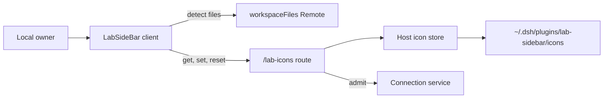
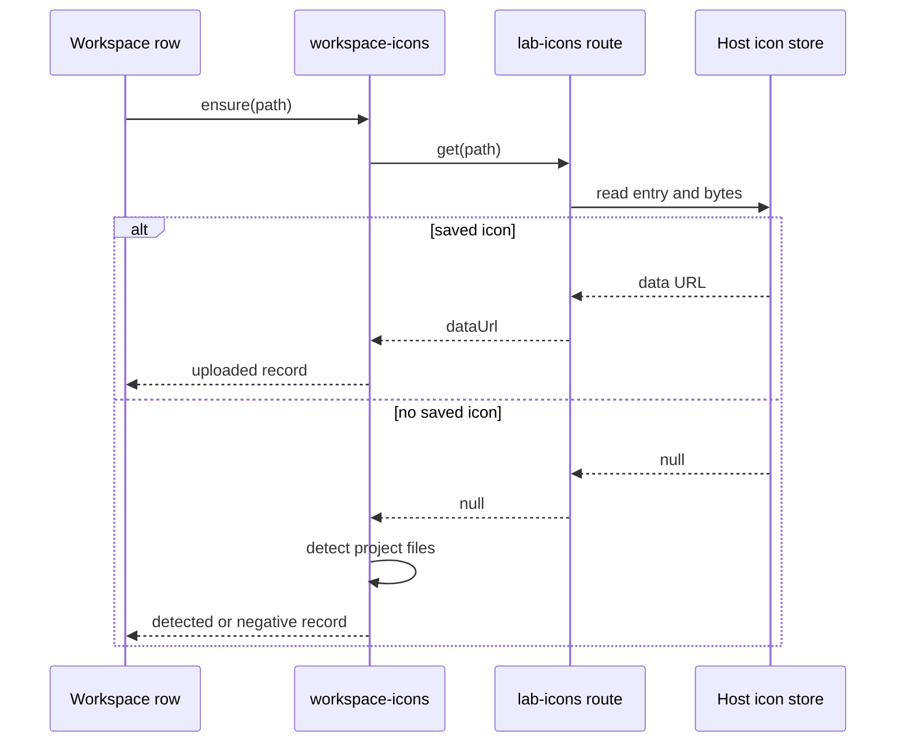
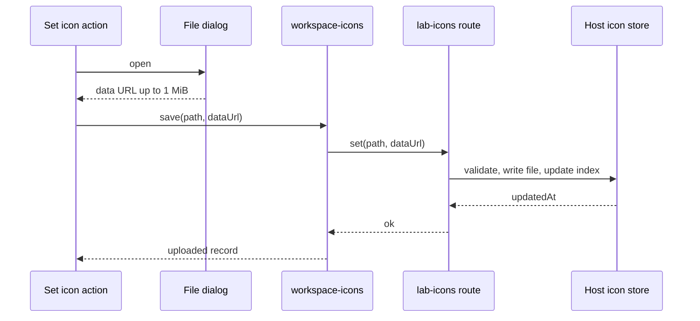

# FEAT-001: Workspace icons

## 1. Snapshot

LabSideBar shows one icon per workspace row in the Harness sidebar. The icon can be detected from files in the project or set by the user through the workspace context menu. This change moves custom icons out of browser localStorage into the Harness profile and raises the accepted source size from 128 KiB to 1 MiB.

| Fact | Value |
| --- | --- |
| User problem | A custom icon disappears for browser clients, crowds a shared localStorage quota, and rejects normal project icons above 128 KiB. |
| Primary actor | The local owner using the desktop window or a browser tab. |
| Trigger | The user picks "Set icon…" in a workspace row menu, or a row mounts and no icon exists yet. |
| Outcome | The chosen icon is stored on the host and served to every client of the same profile. |
| Status | Custom icon storage and the 1 MiB limit are `Current` in the working tree. Detection was verified at commit `fc7ed54`. Live app verification is pending. |

## 2. Problem and Outcome

Current behavior at commit `fc7ed54`:

- Detected and uploaded icons live in one localStorage record, `dsh.lab.icons.v1`, keyed by workspace path.
- A single icon is capped at 128 KiB and the store is capped at 64 records.
- Chromium accepts roughly 4 MiB of characters per origin. A 1 MiB file becomes a 1.37 MiB base64 string, so about three such icons fit. The existing 64 record cap can reach about 11 MiB.
- A quota failure is caught in `writeIconStore` and not reported, so the icon stops persisting without a visible error.
- The desktop window uses the `dsh-app://app` origin, which is stable. A browser tab uses `http://127.0.0.1:<random port>`, a new origin on every app start, so custom icons never appear there.
- The quota is shared with every other key on the origin, including the Harness sidebar state.

Outcome of this change:

- Custom icons are files in the Harness profile, stored by the host plugin and served through the authenticated connection.
- The accepted source size is 1 MiB. The host stores the original bytes, so no base64 expansion or normalization is needed.
- Detection stays in the client. It is re-derived from project files on each start and never persisted.
- No icon data is written to localStorage.

## 3. Scope

Included:

- A host icon store under `~/.dsh/plugins/lab-sidebar/icons`, resolved through `dshHomePath`.
- An authenticated host route `/lab-icons` with `get`, `set`, and `reset`.
- Client load, save, and reset through that route.
- A 1 MiB source limit for detected files, uploads, and host storage.
- Removal of localStorage persistence and its store-versioning code.
- Tests for the store, the route gate, and the client state machine.

Excluded:

- An in-app project file picker. "Set icon…" still opens the operating system file dialog, whose start folder the browser controls.
- Writing icons into the workspace, for example `.dsh/icon.png`.
- Detecting icon changes while the app runs.
- Sharing icons between different Harness profiles or machines.

## 6. User Journey

1. The user opens a workspace row menu and chooses "Set icon…".
2. The browser file dialog opens. The user selects a PNG, SVG, ICO, JPEG, WebP, or GIF up to 1 MiB.
3. The client validates the file, sends the data URL to the host, and the row shows the icon immediately.
4. The host writes the bytes and the index entry. Any later client of the same profile reads the same icon.
5. "Reset icon" removes the stored file, clears the row icon, and runs detection again.

## 7. System Context



The client owns presentation and file detection. The host owns persistence and admission. The workspace files Remote is unchanged and still supplies project file bytes for detection.

## 8. Control Flow





## 9. Data Flow

Host store layout:

```text
~/.dsh/plugins/lab-sidebar/icons/
  index.json
  <sha256 of workspace path>.png
  <sha256 of workspace path>.svg
```

`index.json`:

```json
{
  "version": 1,
  "entries": {
    "/home/me/app": {
      "file": "5f0c...e2.png",
      "mime": "image/png",
      "bytes": 205657,
      "updatedAt": "2026-11-14T00:00:00.000Z"
    }
  }
}
```

Wire values:

| Method | Request | Response |
| --- | --- | --- |
| `get` | `{ path: string }` | `{ dataUrl: string \| null }` |
| `set` | `{ path: string, dataUrl: string }` | `{ updatedAt: string }` |
| `reset` | `{ path: string }` | `{ removed: boolean }` |

## 11. Implementation Map

| Path | Responsibility | Status |
| --- | --- | --- |
| `packages/lab-sidebar/src/client/icons.ts` | Icon records, data URL validation, precedence, and the in-memory store. | Current |
| `packages/lab-sidebar/src/client/detect.ts` | Project icon discovery over a byte reader, with the 1 MiB source cap. | Current |
| `packages/lab-sidebar/src/client/workspace-icons.ts` | Host-backed load, save, and reset, detection runs, negative retry horizon. | Current |
| `packages/lab-sidebar/src/client/icon-store-rpc.ts` | Typed client for the three host methods. | Current |
| `packages/lab-sidebar/src/client/icon-picker.ts` | Operating system file dialog and data URL read, capped at 1 MiB. | Current |
| `packages/lab-sidebar/src/client/plugin/client/index.ts` | Icon context menu, connection wiring, and the shared store. | Current |
| `packages/lab-sidebar/src/client/plugin/client/rows/Rows.tsx` | Renders the icon or the folder fallback. | Current |
| `packages/lab-sidebar/src/host/store.ts` | Validate icons, write bytes, maintain and evict the index. | Current |
| `packages/lab-sidebar/src/host/http.ts` | Authenticated `/lab-icons` route and admission gate. | Current |
| `packages/lab-sidebar/src/host/index.ts` | Compose the store and route at plugin apply. | Current |
| `scripts/build-host.mjs` | Bundle the host half into `index.js`. | Current |
| `tsconfig.host.json` | Node-typed check for the host half. | Current |
| `package.json` | Bundle and typecheck scripts include the host half. | Current |
| `packages/lab-sidebar/client.js` | Generated client bundle. | Generated |
| `packages/lab-sidebar/index.js` | Generated host bundle. | Generated |

The pre-change implementation at `fc7ed54` kept detected and uploaded icons in localStorage. This change removed that persistence.

## 14. Business Rules

- **BR-001**: A saved custom icon always outranks a detected icon for the same workspace path.
- **BR-002**: Detection runs only when no saved icon exists and no record is already present.
- **BR-003**: An icon source may not exceed 1 MiB. The limit applies to the decoded bytes, not the base64 text.
- **BR-004**: Accepted formats are PNG, JPEG, WebP, GIF, SVG, and ICO. The bytes must match the declared type.
- **BR-005**: The host stores the original bytes and the MIME type. It never stores the base64 text.
- **BR-006**: The store keeps at most 200 entries and 32 MiB in total. The oldest records are removed first.
- **BR-007**: A load failure does not stop detection. When detection finds nothing, no record is written and the row retries on the next mount.
- **BR-008**: Reset removes the saved file before clearing the local record. A failed removal leaves the record in place.
- **BR-009**: Any admitted peer may read icons. Only the owner principal may set or reset them.
- **BR-010**: The index is the only source of file names. An entry whose file name is not a lowercase SHA-256 plus a known extension is ignored.

## 15. Acceptance Criteria

- **AC-001**: A saved icon is served after the host process restarts.
- **AC-002**: No icon data is written to localStorage.
- **AC-003**: A 1 MiB icon is accepted and a 1 MiB plus one byte icon is rejected by the client and by the host.
- **AC-004**: A saved icon wins over a project file that detection would find.
- **AC-005**: Reset removes the saved file and falls back to detection.
- **AC-006**: A corrupt or unreadable index starts an empty store without a crash.
- **AC-007**: A non-owner peer may read an icon and may not set or reset one.
- **AC-008**: The store evicts the oldest entries beyond the count and byte caps.
- **AC-009**: A tampered index entry with a path-like file name is ignored.
- **AC-010**: A failed host load falls back to detection and caches no miss when detection finds nothing.

## 17. Security and Privacy

- The route uses the Connection admission check and the owner principal for writes, following the Git desk route.
- Request bodies are capped at 2 MiB. A data URL above the icon cap is rejected before any file write.
- The server never derives a path from client input. File names are SHA-256 hashes of the workspace path plus a MIME-derived extension.
- The index parser rejects entries whose file name does not match the hash plus extension pattern, so a tampered index cannot point at another file.
- The store directory is created with mode 0700 and files with mode 0600.
- Workspace paths are stored in the profile index. They are local user data and are not sent anywhere else.
- The data URL regex accepts only base64 image MIME types. SVG content is checked for `<svg` before writing.

## 20. Testing

Commands:

```bash
npm run typecheck
npm test
npm run bundle
```

New and updated tests:

| Criterion | Test |
| --- | --- |
| AC-001 | Store round trip on a new instance over the same directory. |
| AC-002 | Source inspection plus `workspace-icons` tests that use no storage dependency. |
| AC-003 | Client `fitsIconLimit` and host `set` at the 1 MiB boundary. |
| AC-004 | `ensure` with a saved icon and a detection reader that must not run. |
| AC-005 | `reset` calls the host remove and then detection. |
| AC-006 | `parseIndex` over invalid JSON and invalid entries. |
| AC-007 | Route gate function over owner and non-owner peers. |
| AC-008 | Store configured with small caps evicts oldest first. |
| AC-009 | `parseIndex` drops a traversal-shaped file name. |
| AC-010 | `ensure` with a throwing load falls back to detection and caches no miss. |
| AC-001, AC-003, AC-005, AC-007 | `tests/icon-route.test.mjs` drives the route over HTTP. |
| AC-001, AC-003, AC-005 to AC-009 | `tests/icon-store.test.mjs` covers the store and the gate. |

Manual verification after a restart:

1. Set an icon on a workspace, close the app, start it again, confirm the icon is still shown.
2. Open the browser URL and confirm the same icon is shown.
3. Reset the icon and confirm detection takes over.

## 24. Implementation Plan

**Phase 1: host store**

- Add `store.ts` with validation, atomic file and index writes, eviction, and the index parser.
- Add `http.ts` with the `/lab-icons` route and the owner gate.
- Add `index.ts` that resolves the directory through `dshHomePath` and registers the route.
- Add `scripts/build-host.mjs` and include it in `npm run bundle`.
- Validation: `npm run typecheck`, the new store tests, and `npm run bundle`.

**Phase 2: client**

- Reduce `icons.ts` to in-memory records and validation. Raise the limit to 1 MiB.
- Add `icon-store-rpc.ts`.
- Change `workspace-icons.ts` to load, save, and remove through injected host functions.
- Wire `connection` into the client plugin and remove the localStorage dependency.
- Update the file picker limit and the eight `icon.failed` strings.
- Validation: `npm run typecheck`, `npm test`, `npm run bundle`.

**Phase 3: live verification**

- Restart the app, set an icon, restart again, and check the desktop window and a browser tab.
- Rollback: delete `~/.dsh/plugins/lab-sidebar/icons` and restore the previous bundle. The legacy localStorage record is left untouched and becomes unused.

Phases 1 and 2 are implemented in the working tree. Typecheck, the test suite, and both bundles pass. Phase 3, live restart verification, remains.

## 26. Risks

| Risk | Impact | Mitigation |
| --- | --- | --- |
| The host half fails to load, so no custom icons persist. | Set and load fail; detection still works. | The client falls back to detection and retries the host on the next mount when nothing is found. A failed save surfaces the menu failure label. |
| A 1 MiB icon is returned as a 1.37 MiB JSON value on the first row mount. | Memory and RPC cost for many workspaces. | Loads are per path and cached in the client store for the session. Count and byte caps bound the store. |
| Detection reads up to 1 MiB plus one byte per candidate file. | More bytes over the workspace files RPC. | The workspace files cap is 2 MiB, so the window is valid. Reads stop at the first usable icon. |
| The working tree is dirty at implementation time. | `last_verified_commit` cannot name a commit. | Verification names the working tree date until the work is committed. |
| An old localStorage icon set is not migrated. | A user must set the icon again after this change. | The old record is ignored, not deleted. The legacy data can be migrated later if needed. |

## 30. Changelog

| Date | Version | Change |
| --- | --- | --- |
| 2026-11-14 | 2.0.0 | Host-backed custom icons, a 1 MiB source limit, and removal of localStorage persistence. Tests pass; live verification pending. |
| 2026-11-13 | 1.0.0 | Detected workspace icons and localStorage uploads, commit `fc7ed54`. |
