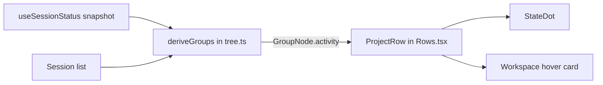
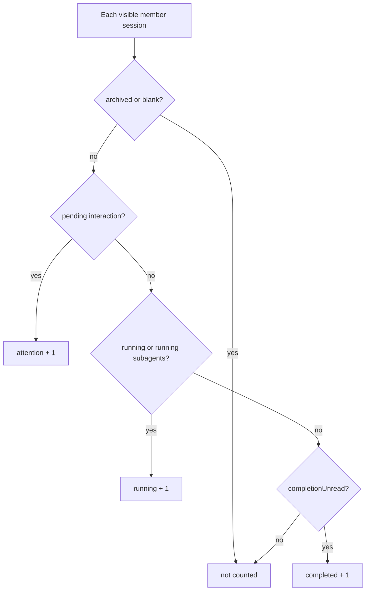

# FEAT-002: Workspace activity indicator

## 1. Snapshot

Each workspace row in the LabSideBar tree shows one status dot that summarizes the sessions inside it. The user can see which projects have work running, need an answer, or finished unseen, without expanding each workspace.

| Fact | Value |
| --- | --- |
| User problem | Status dots exist only on session rows. A collapsed workspace, or a session below the "show more" fold, hides that a project is running or waiting. |
| Primary actor | The local owner working in several workspaces at once. |
| Trigger | Any session status change: run start, run stop, pending approval, plan review, question, completion acknowledged. |
| Outcome | The workspace row shows the highest-priority state among its sessions, and its hover card lists counts. |
| Status | Implemented in the working tree. Tests and bundle pass. Live GUI check pending. |

## 2. Problem and Outcome

Current behavior at `c9b3076`:

- `sessionStatuses` in `Rows.tsx` maps one session to a `StateDot` state. Pending interaction is `warning`, a running session or running subagent is `ongoing`, an unread completion is `done`, otherwise `idle`.
- `deriveGroups` in `tree.ts` builds `SessionNode` values only for expanded groups. A folded group has `sessions: []`, so no status facts reach the workspace row.
- `ProjectRow` renders the icon or folder, the title, and hover actions. It has no status.

Outcome:

- `GroupNode` carries an `activity` summary computed from every visible member, whether or not the group is expanded.
- `ProjectRow` shows one `StateDot` at the trailing edge of the row when the summary is not idle.
- The workspace hover card lists one line per non-zero count, for example "2 running" and "1 waiting for you".

## 3. Scope

Included:

- Workspace rows and the Ungrouped row in the grouped view.
- Status rollup from top-level sessions, including their running subagent count.
- Localized counts in all eight dictionaries.

Excluded:

- The flat view and search results, which already show a dot per session.
- Notifications, sounds, or a window badge.
- Any new persisted state. Completion acknowledgement stays with the existing `completionUnread` flag, which clears when the session is opened.

## 6. User Journey

1. The user starts runs in workspaces A and B, then collapses both.
2. Both rows show the grey spinning `ongoing` dot.
3. A run in A asks for approval. Row A switches to the amber `warning` dot.
4. The run in B finishes while the user is in A. Row B shows the green `done` dot.
5. The user opens the finished session in B. Its completion is acknowledged and row B shows no dot.
6. Hovering row A shows "1 waiting for you" and "1 running".

## 7. System Context



The browser already subscribes to the status snapshot and passes it to `deriveGroups`. The change adds one field to the derived group. No new subscription, host call, or storage is needed.

## 8. Control Flow



Each session counts once, in its highest-priority bucket. The row dot is `warning` when attention is above zero, else `ongoing` when running is above zero, else `done` when completed is above zero, else no dot.

## 9. Data Flow

Planned addition to `GroupNode` in `tree.ts`:

```ts
interface WorkspaceActivity {
  attention: number
  running: number
  completed: number
}
```

## 11. Implementation Map

| Path | Responsibility | Status |
| --- | --- | --- |
| `packages/lab-sidebar/src/client/plugin/client/tree.ts` | `WorkspaceActivity`, `groupActivity`, `subtreeActivity`, and `GroupNode.activity`. | Current |
| `packages/lab-sidebar/src/client/plugin/client/rows/WorkspaceBrowser.tsx` | Picks own or subtree counts per row and sets `includesNested`. | Current |
| `packages/lab-sidebar/src/client/plugin/client/rows/Rows.tsx` | `activityLines`, trailing dot, screen-reader label, hover card count lines. | Current |
| `packages/lab-sidebar/src/client/plugin/client/rows/Rows.module.css` | `.activity` cell, hidden on hover and while the row menu is open. | Current |
| `packages/lab-sidebar/src/client/plugin/client/locales.ts` | `activity.*` strings in eight languages. | Current |
| `packages/lab-sidebar/tests/workspace-activity.test.mjs` | Rollup tests. | Current |
| `packages/lab-sidebar/client.js` | Generated client bundle. | Generated |

## 14. Business Rules

- **BR-001**: A session counts in exactly one bucket, chosen in the order attention, running, completed.
- **BR-002**: A running subagent makes its parent session count as running.
- **BR-003**: Archived sessions and the blank New Session row are not counted.
- **BR-004**: The rollup covers every visible member, including folded groups and rows hidden below the "show more" fold.
- **BR-005**: The row dot priority is warning, then ongoing, then done. An all-zero summary shows no dot.
- **BR-006**: The dot hides while the row's hover actions are visible, the same way session rows swap their trailing time for actions.
- **BR-007**: A folded workspace's dot and hover card include every nested workspace below it. An unfolded workspace shows only its own sessions, because its nested rows show their own dots.
- **BR-008**: The dot stays visible while the workspace is unfolded.

## 15. Acceptance Criteria

- **AC-001**: A folded workspace with one running session has `activity.running === 1`.
- **AC-002**: A session that is running and awaiting approval counts only as attention.
- **AC-003**: An idle session with a running subagent counts as running.
- **AC-004**: Archived and blank sessions add nothing to any count.
- **AC-005**: A session whose completion is unread counts as completed, and counts nothing after `completionUnread` becomes false.
- **AC-006**: A workspace with attention 1 and running 2 renders a `warning` dot and an accessible label naming both counts.
- **AC-007**: An all-zero workspace renders no dot.
- **AC-008**: A session below the "show more" fold still counts.
- **AC-009**: A folded parent's counts include nested workspaces at any depth.

## 20. Testing

Commands:

```bash
npm run typecheck
npm test
npm run bundle
```

| Criterion | Test |
| --- | --- |
| AC-001 to AC-005, AC-008 | `tests/workspace-activity.test.mjs` drives `deriveGroups` with list, workspace, and status fixtures. |
| AC-009 | `tests/workspace-activity.test.mjs` checks `subtreeActivity` over three levels. |
| AC-006, AC-007 | A throwaway render of `ProjectRowItem` in jsdom confirmed the warning dot with the label "1 waiting for you, 2 running" and no dot when idle. Live GUI check pending. |

## 24. Implementation Plan

**Phase 1: rollup**

- Add `WorkspaceActivity` and the rollup to `tree.ts`, computed over all visible members before the expansion check.
- Validation: the new tests, `npm run typecheck`.

**Phase 2: row**

- Render the trailing dot and visually hidden label in `ProjectRow`, and count lines in `WorkspaceHoverContent`.
- Add the strings to all eight dictionaries.
- Validation: `npm run typecheck`, `npm test`, `npm run bundle`, then refresh the GUI and check a running, waiting, and finished session.

Rollback: revert the commit and rebuild `client.js`. No state is stored.

## 26. Risks

| Risk | Impact | Mitigation |
| --- | --- | --- |
| The rollup runs over every member on each status change. | Extra work per render with many sessions. | It is one pass over member ids already walked by `groupByWorkspace`, inside the existing `useMemo`. |
| A nested child workspace hidden under a folded parent hides its activity. | The user misses a running child project. | DEC-001 rolls nested counts into the folded parent. |

## 29. Decisions

- **DEC-001**: A folded parent includes nested workspaces (former Q-001). Approved after the interactive preview on 2026-11-14.
- **DEC-002**: The dot stays visible on unfolded workspaces (former Q-002), because sessions below the fold and a scrolled list still hide state.
- **DEC-003**: No count beside the dot. Counts live in the hover card and the screen-reader label.

## 30. Changelog

| Date | Version | Change |
| --- | --- | --- |
| 2026-11-14 | 1.0.0 | Implemented with DEC-001 to DEC-003. Tests and bundle pass; live check pending. |
| 2026-11-14 | 0.1.0 | Proposed plan. |
