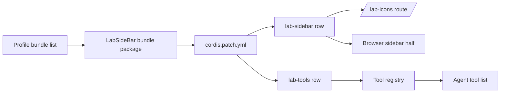
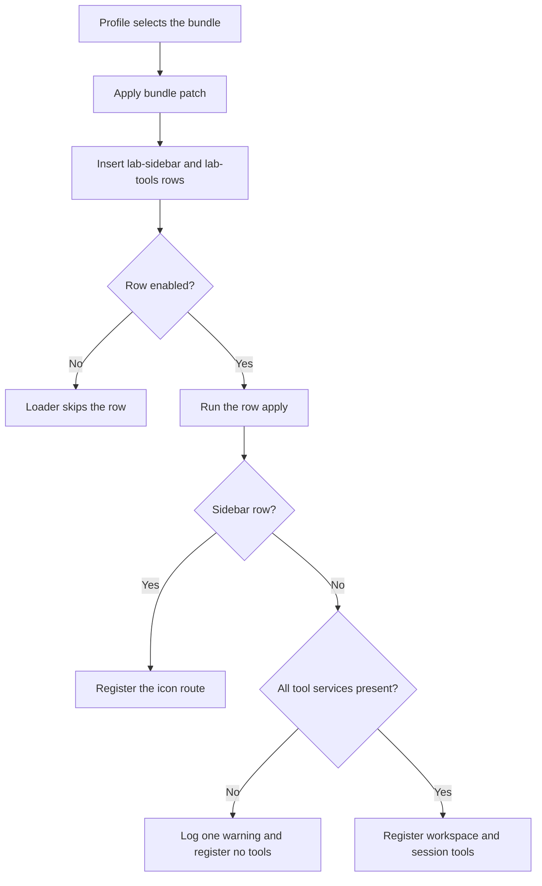
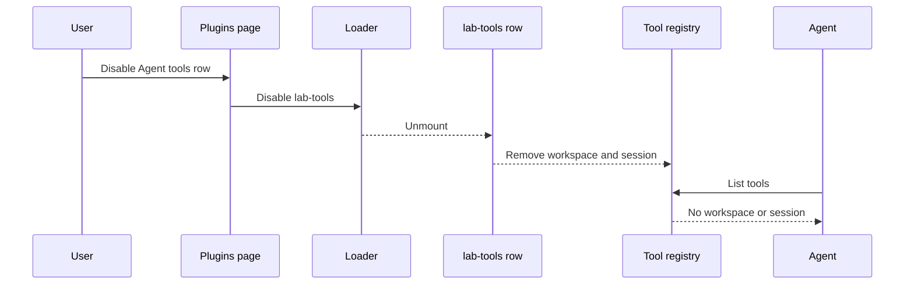

# Single bundle with optional agent tools

> Install LabSideBar once, get the sidebar and the agent tools, and switch the agent tools off from the same plugin row when they are not wanted.

## 1. Feature Snapshot

| Field | Details |
| --- | --- |
| Document status | Active |
| Implementation status | Shipped, live visual check pending |
| Owner | Parth Patel |
| Primary actors | The local owner installing the plugin; the agent calling the tools |
| Trigger | Installing the LabSideBar bundle, or switching its Agent tools row in Plugins |
| Outcome | One installed bundle with two independent plugin rows: the sidebar row and the agent tools row |
| Entry points | Profile bundle selection, `packages/lab-sidebar/cordis.patch.yml`, the tool registry |
| Data stores | None new. The workspace icon store is unchanged. |
| Feature flag | The `lab-tools` row enable/disable switch |
| Last verified | Working tree on 2026-11-14. No commit contains this change yet. |

**Status legend.** Every `Status` value below is one of: **Current** (read in the code at `last_verified_commit`) · **Planned** (not implemented) · **Inferred** (not directly verified against a commit) · **Unknown**.

**Verification note.** The change is implemented in the working tree, not in a commit, so no claim below is labeled `Current`. The tests and the live profile check ran against that working tree on 2026-11-14.

## 2. Problem and Outcome

**Problem.** LabSideBar shipped as two installed bundles, `dsh-lab-sidebar` and `dsh-lab-tools`. A user who wanted the sidebar but not model-callable workspace and session mutations had to install, update, and remove two packages independently. The two halves also shipped separate patches and separate display entries.

**Desired outcome.** One bundle package provides both plugin rows. The user sees one LabSideBar bundle in Plugins. The Agent tools row has its own switch, so the user can turn the two tools off without losing the sidebar, the icon store, or the workspace UI.

**How success is measured.** The Plugins page lists one LabSideBar bundle with two rows. With the Agent tools row enabled, the model can call `workspace` and `session`. With it disabled, those tools are absent and the sidebar row stays active.

## 3. Scope

**Included**

- Merge the tools host plugin into the `packages/lab-sidebar` bundle package.
- One `cordis.patch.yml` inserts both `lab-sidebar` and `lab-tools`.
- Move the tools sources, tests, build entry, and typecheck entry into the merged package.
- Keep the tool definitions, parameters, results, and approval behavior unchanged.
- Export display metadata for the merged bundle and its tools row.
- Remove the separate `packages/lab-tools` package and its profile dependency.

**Excluded**

- A single row with a boolean config option instead of two rows.
- New tool actions, new host services, or a changed approval policy.
- Changing the sidebar UI, the icon route, or the icon storage format.
- Flattening the repository to a root package.
- Renaming the installed bundle or the two row ids.

**Assumptions**

| ID | Assumption | Confidence | How it was validated |
| --- | --- | --- | --- |
| ASM-001 | The Plugins page switches a single row of an installed bundle on and off. | High | `plugin_manager` `set_plugin` applied the switch live to `include:lab-tools`. |
| ASM-002 | The linked package picks up the changed patch after the profile selects the bundle again. | Medium | The live bundle list reads both rows from the linked package without reinstalling it. |
| ASM-003 | A new package generation needs a window reload before the client half changes. | High | Not exercised; the client bundle was rebuilt but not visually reloaded. |

## 6. User Journey

1. The user opens Plugins and installs or links the LabSideBar bundle once.
2. The Installed page shows one LabSideBar bundle. Its details list the sidebar row and the Agent tools row.
3. Both rows start enabled. The sidebar shows workspace icons and activity, and the agent can call `workspace` and `session`.
4. The user switches the Agent tools row off.
5. The loader stops the tools plugin. The agent tool list no longer contains `workspace` or `session`. The sidebar row stays active.
6. The user switches the Agent tools row on again. Both tools return to the tool list.

**Alternate paths**

| Journey | Trigger | Expected outcome |
| --- | --- | --- |
| Missing host service | The profile has no `approval` or controller service | The tools row logs one warning and registers no tools; the sidebar row still loads. |
| Stale old bundle | `dsh-lab-tools` is still selected during migration | The bundle is marked missing with no rows. Remove it before verifying the merged rows. |
| Rollback | The merged bundle fails to load | Uninstall it, restore the two old packages, and reinstall the previous bundle set. |

## 7. System Context

The profile selects one bundle. The bundle patch inserts two plugin rows, and the loader mounts each row independently. The tools row talks to the tool registry; the sidebar row keeps its host icon route and browser half.



The patch is the only composition input. Removing one row does not change the package or the other row.

## 8. Control Flow



| Step | Status | Controlling component | Failure behavior |
| --- | --- | --- | --- |
| Bundle selection | Inferred | Profile bundle list | The bundle does not appear in Plugins. |
| Patch insertion | Inferred | Loader patch application | The row is missing or reported as invalid. |
| Row switch | Inferred | Plugins page and loader | The previous activation state remains until the change applies. |
| Tool registration | Inferred | Tools plugin apply | One warning, no tools; the sidebar is unaffected. |

## 9. Data Flow

No new persisted data. The profile stores the bundle selection and the per-row enable state. The icon store under `~/.dsh/plugins/lab-sidebar/icons` keeps its path and format. Tool calls keep their request and result shapes.



**Sensitive data.** None new. Tool calls still touch workspace and session metadata under the existing host services, and workspace deletion still uses the existing approval prompt.

## 11. Implementation Map

### Implemented in the working tree

| Layer | Responsibility | Repository path | Main symbol | Status |
| --- | --- | --- | --- | --- |
| Bundle manifest | One bundle with the sidebar, tools, client, locale, and icon exports | `packages/lab-sidebar/package.json` | `dsh-lab-sidebar` | Inferred |
| Bundle patch | Disables the shipped workspace row and inserts both rows | `packages/lab-sidebar/cordis.patch.yml` | `lab-sidebar`, `lab-tools` | Inferred |
| Sidebar host plugin | Registers the authenticated icon store route | `packages/lab-sidebar/src/host/index.ts` | `apply` | Inferred |
| Client entry | Activates the workspace UI and stylesheet | `packages/lab-sidebar/src/client/index.tsx` | `apply` | Inferred |
| Tools plugin | Registers both tools from the merged package | `packages/lab-sidebar/src/tools/index.ts` | `apply` | Inferred |
| Tool definitions | Defines parameters, results, and destructive approval | `packages/lab-sidebar/src/tools/tools.ts` | `createTools` | Inferred |
| Tool operations | Wraps the host workspace and session services | `packages/lab-sidebar/src/tools/ops.ts` | `listWorkspaces`, `listSessions` | Inferred |
| Tool validation | Narrows arguments and enforces title and path rules | `packages/lab-sidebar/src/tools/validate.ts` | `readAction`, `requireAbsolutePath` | Inferred |
| Tool approval | Asks before a workspace delete | `packages/lab-sidebar/src/tools/approve.ts` | `confirmDestructive` | Inferred |
| Tools build | Emits `tools.js` in the merged package | `scripts/build-tools.mjs` | esbuild | Inferred |
| Client build | Emits the browser bundle | `scripts/build-client.mjs` | esbuild | Inferred |
| Bundle test | Asserts one bundle, two resolvable rows, metadata, and build artifacts | `packages/lab-sidebar/tests/bundle.test.mjs` | node:test | Inferred |
| Tools tests | Exercises registration, actions, validation, and approval | `packages/lab-sidebar/tests/tools.test.mjs` | node:test | Inferred |
| Icon tests | Exercises route admission, storage, detection, and reset | `packages/lab-sidebar/tests/icon-route.test.mjs`, `icon-store.test.mjs`, `icons.test.mjs`, `detect.test.mjs`, `icon-store-rpc.test.mjs`, `workspace-icons.test.mjs` | node:test | Inferred |
| Activity tests | Exercises the workspace activity rollup | `packages/lab-sidebar/tests/workspace-activity.test.mjs` | node:test | Inferred |
| Bundle locale | Bundle title and description | `packages/lab-sidebar/locale/en.json`, `locale/zh.json` | `meta.title` | Inferred |
| Tools row locale | Tools row title and description | `packages/lab-sidebar/tools/locale/en.json`, `tools/locale/zh.json` | `meta.title` | Inferred |
| Tools row icon | Tools row artwork | `packages/lab-sidebar/tools/icon.svg` | SVG | Inferred |

### Generated or restricted

| Path or area | Classification | Rule |
| --- | --- | --- |
| `packages/lab-sidebar/index.js` | Generated | Rebuild with `scripts/build-host.mjs`; do not edit by hand. |
| `packages/lab-sidebar/tools.js` | Generated | Rebuild with `scripts/build-tools.mjs`; do not edit by hand. |
| `packages/lab-sidebar/client.js` | Generated | Rebuild with `scripts/build-client.mjs`; do not edit by hand. |
| `package-lock.json` | Generated | Update through the workspace package manager. |
| Profile `package.json` and `cordis.patch.yml` | Restricted | Change through the plugin manager, not by hand. |

## 14. Business Rules

| Rule ID | Status | Rule | Enforcement point | Test reference |
| --- | --- | --- | --- | --- |
| BR-001 | Inferred | One installed bundle provides both the sidebar row and the tools row. | `packages/lab-sidebar/cordis.patch.yml` | `tests/bundle.test.mjs` |
| BR-002 | Inferred | The `lab-tools` row resolves to `dsh-lab-sidebar/tools`. | Bundle patch and package exports | `tests/bundle.test.mjs` |
| BR-003 | Inferred | Disabling the tools row leaves the sidebar row active and the icon route registered. | Loader row independence | Live row switch; `tests/icon-route.test.mjs` |
| BR-004 | Inferred | An enabled tools row registers exactly the `workspace` and `session` tools. | `src/tools/tools.ts` | `tests/tools.test.mjs`; live tool list |
| BR-005 | Inferred | Row ids stay `lab-sidebar` and `lab-tools`. | Bundle patch | `tests/bundle.test.mjs` |
| BR-006 | Inferred | The bundle patch still disables the shipped `ui-workspace` row. | Bundle patch | `tests/bundle.test.mjs` |
| BR-007 | Inferred | Tool parameters, results, and approval behavior do not change. | `src/tools/` | `tests/tools.test.mjs` |
| BR-008 | Inferred | The profile has one LabSideBar bundle dependency instead of two. | Profile package manifest | Live bundle list |
| BR-009 | Inferred | A missing host service makes the tools row register no tools and log one warning; it never prevents the sidebar row from loading. | `src/tools/index.ts` | `tests/tools.test.mjs` AC-017 |

## 15. Acceptance Criteria

**Verification result on 2026-11-14.** `npm run typecheck` and `npm run bundle` passed. `npm test` passed 91 tests. The live profile listed one `dsh-lab-sidebar` bundle with two rows. Disabling `include:lab-tools` removed `workspace` and `session` from the 73-tool list. Enabling it restored them in the 75-tool list, and both tools ran a list action. The sidebar was not visually reloaded.

### AC-001: One bundle entry

**Given** a profile with the merged bundle installed
**When** the user opens Plugins
**Then** LabSideBar appears once
**And** no separate LabSideBar tools bundle appears.
**Verified by** the live bundle list.

### AC-002: Two rows

**Given** the merged bundle is selected
**When** the loader composes the profile
**Then** it contains a `lab-sidebar` row and a `lab-tools` row
**And** both row names resolve inside the merged package.
**Verified by** the live plugin list and `tests/bundle.test.mjs`.

### AC-003: Tools off

**Given** both rows are enabled and the tools are registered
**When** the user disables the `lab-tools` row
**Then** the agent tool list no longer contains `workspace` or `session`
**And** the sidebar row stays active.
**Verified by** the live row switch and tool list.

### AC-004: Tools on

**Given** the `lab-tools` row is disabled
**When** the user enables it again
**Then** the agent tool list contains `workspace` and `session`
**And** both tools run their existing actions.
**Verified by** the live row switch, tool list, and one list action per tool.

### AC-005: Sidebar isolation

**Given** the `lab-tools` row is disabled
**When** the user sets or resets a workspace icon
**Then** the icon is saved or removed through `/lab-icons` as before.
**Verified by** `tests/icon-route.test.mjs` and `tests/icon-store.test.mjs`. The live icon dialog was not exercised.

### AC-006: Tool behavior unchanged

**Given** the moved tools tests
**When** they run against the merged package
**Then** every existing tool acceptance criterion still passes.
**Verified by** `npm test`: 91 passing tests, 0 failures.

### AC-007: Build artifacts

**Given** a clean checkout
**When** `npm run bundle` finishes
**Then** `packages/lab-sidebar/index.js`, `tools.js`, and `client.js` exist
**And** the bundle test resolves both rows to those files.
**Verified by** `npm run bundle` and `tests/bundle.test.mjs`.

### AC-008: Migration

**Given** a profile with `dsh-lab-sidebar` and `dsh-lab-tools` installed
**When** the migration installs the merged bundle and removes the old tools bundle
**Then** only the merged bundle is selected
**And** both rows mount from it.
**Verified by** the live profile after `remove_bundle` on `dsh-lab-tools`.

### Edge cases

| Case ID | Scenario | Expected behavior | Test type |
| --- | --- | --- | --- |
| CASE-001 | The tools row is disabled while a tool call is running | The run keeps its existing cancellation control; the row unmounts after the turn. | Not exercised |
| CASE-002 | The profile lacks an `approval` service | The tools row warns and registers nothing; the sidebar loads. | Unit |
| CASE-003 | The old tools bundle is still selected | The bundle is marked missing and has no rows; remove it before verifying. | Live check |
| CASE-004 | The patch cannot resolve `dsh-lab-sidebar/tools` | The bundle test fails on the export before installation. | Unit |
| CASE-005 | The linked package is rebuilt | The host module applies after the plugin manager change; the browser half needs a window reload. | Live check, host only |

## 17. Security and Privacy

| ID | Requirement | Enforcement | Validation |
| --- | --- | --- | --- |
| SEC-001 | Disabling the tools row removes model access to workspace and session mutations. | Loader row switch | Live tool list check: 73 tools without both, 75 with both. |
| SEC-002 | Workspace deletion keeps its existing approval prompt. | `src/tools/approve.ts` | `tests/tools.test.mjs` AC-007 and AC-008. |
| SEC-003 | The merge adds no credential, network, or storage access. | No new services or files | Code review of the moved sources. |
| SEC-004 | The icon route keeps its owner-only write rule. | `src/host/http.ts` | `tests/icon-route.test.mjs` AC-007. |

## 20. Testing

| Test type | Required coverage | Path |
| --- | --- | --- |
| Unit | Patch, exports, metadata, and generated files resolve for both rows | `packages/lab-sidebar/tests/bundle.test.mjs` |
| Unit | Tool registration, actions, validation, and approval | `packages/lab-sidebar/tests/tools.test.mjs` |
| Unit | Icon route admission, storage, and reset | `packages/lab-sidebar/tests/icon-route.test.mjs`, `icon-store.test.mjs` |
| Unit | Client icon state, detection, and activity | `packages/lab-sidebar/tests/icons.test.mjs`, `detect.test.mjs`, `icon-store-rpc.test.mjs`, `workspace-icons.test.mjs`, `workspace-activity.test.mjs` |
| Integration | Row switch in the live profile and agent tool list | Plugins page plus `cordis_inspect_query` |

**Validation commands**

```bash
npm run typecheck
npm run bundle
npm test
```

Live check performed on 2026-11-14:

1. Listed the profile bundles and rows.
2. Disabled `include:lab-tools`; the tool list dropped from 75 to 73 and lost `workspace` and `session`.
3. Enabled `include:lab-tools`; the tool list returned to 75 with both names.
4. Ran `workspace` `list` and `session` `list` from the merged package.
5. Removed the old `dsh-lab-tools` bundle and confirmed one LabSideBar bundle remained.

## 26. Risks and Limitations

| Risk ID | Risk | Impact | Mitigation |
| --- | --- | --- | --- |
| RISK-001 | The browser half was rebuilt but not visually reloaded. | A client rendering defect would not show in this verification. | Reload the window and check the sidebar rows before calling the visual check complete. |
| RISK-002 | The live check used `set_plugin` rather than clicking the Plugins page. | The UI path to the same switch is unverified. | Confirm the Agent tools row appears under View in Plugins on the next window reload. |
| RISK-003 | The old `dsh-lab-tools` symlink remains in the profile `node_modules`. | A stale broken link remains after the dependency is gone. | It has no bundle row or package entry; a later profile install can clean it. |
| RISK-004 | The tools row is disabled while a tool call is in flight. | The call may fail instead of finishing. | Existing run cancellation handles active turns; CASE-001 remains untested. |
| RISK-005 | No commit contains this change. | The feature document cannot cite a verification commit. | Commit the working tree when requested, then set `last_verified_commit` and refresh this section. |

## 29. Decisions

- **DEC-001**: Use one package with two rows, not one row with a boolean config option. The DSH Plugins page switches individual rows, so this is the native enable/disable control and matches `dsh-artifact-studio`. Approved on 2026-11-14.
- **DEC-002**: Keep the package name `dsh-lab-sidebar` and the row ids `lab-sidebar` and `lab-tools` to avoid a profile migration beyond removing the old tools bundle. Approved on 2026-11-14.
- **DEC-003**: Keep the tool contracts and the destructive-action approval unchanged. The merge is packaging only. Approved on 2026-11-14.

## 30. Changelog

| Date | Version | Change | Status | PR or author |
| --- | --- | --- | --- | --- |
| 2026-11-14 | 1.0.0 | Merged the tools package into the LabSideBar bundle, added the independent tools row, and verified the row switch. | Shipped, live visual check pending | Parth Patel |
| 2026-11-14 | 0.1.0 | Proposed the single-bundle merge and the per-row tools switch. | Proposed | Parth Patel |
